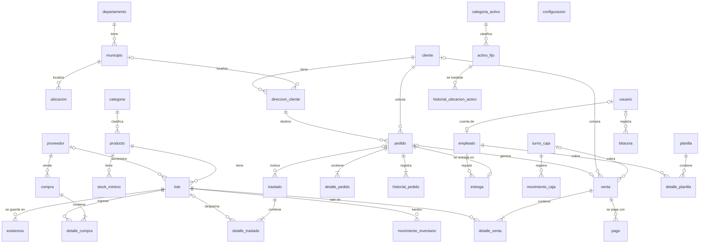
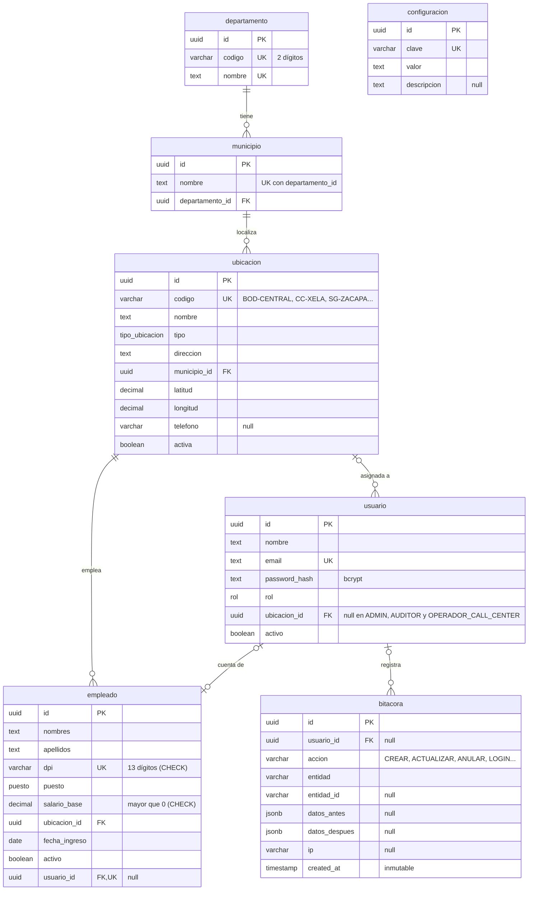
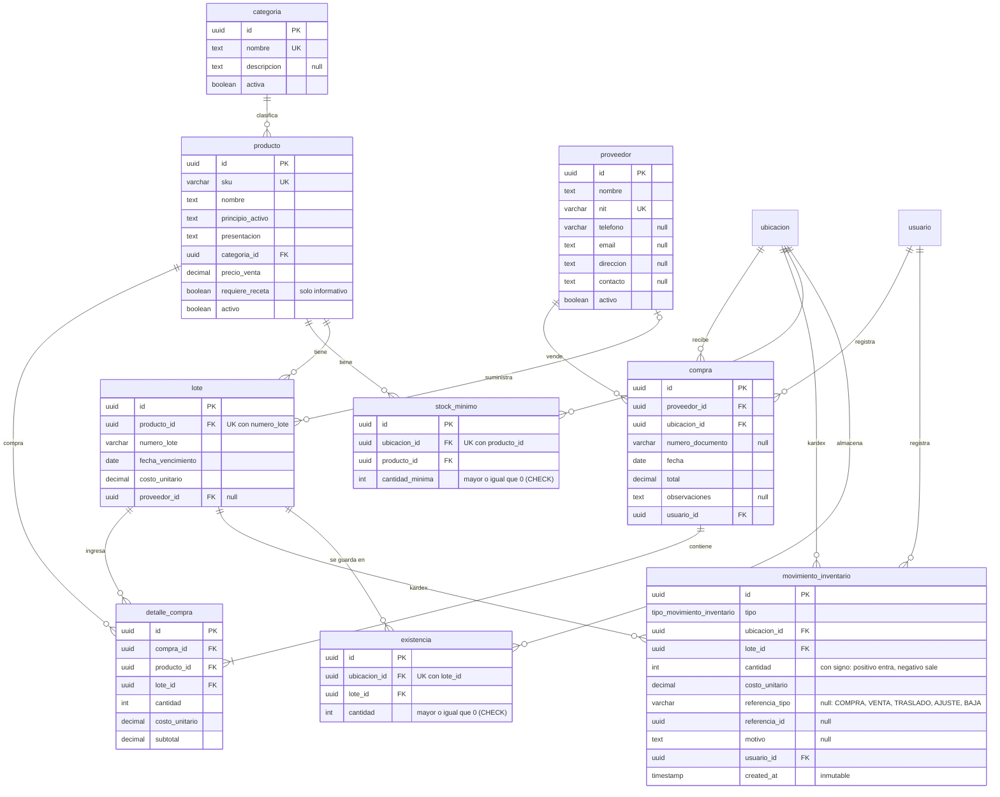
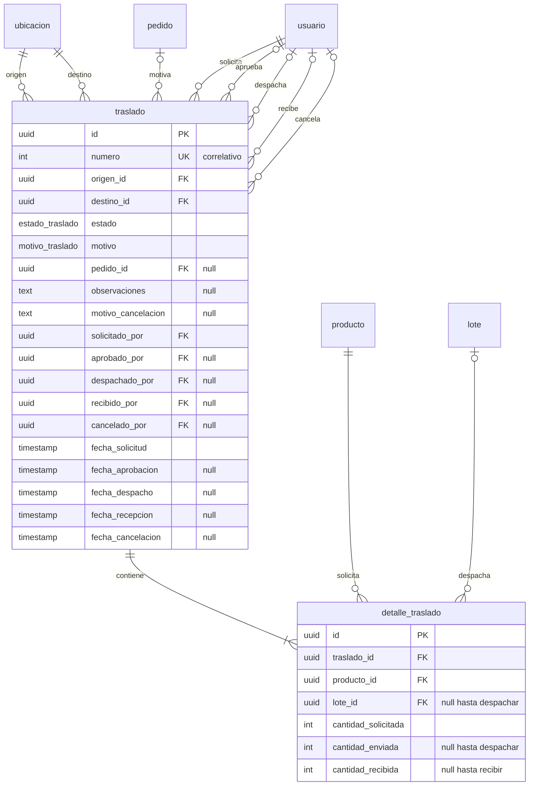
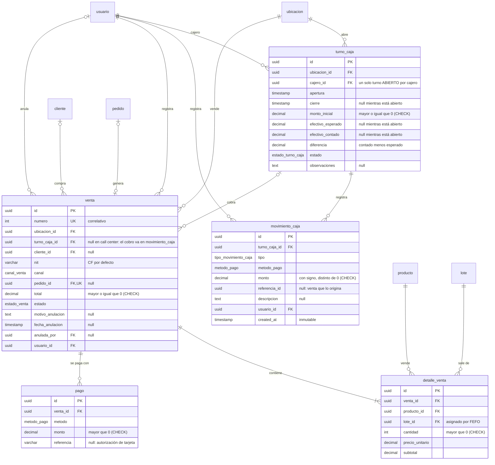
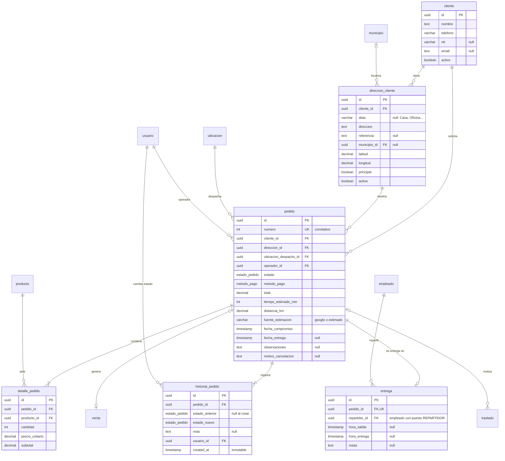
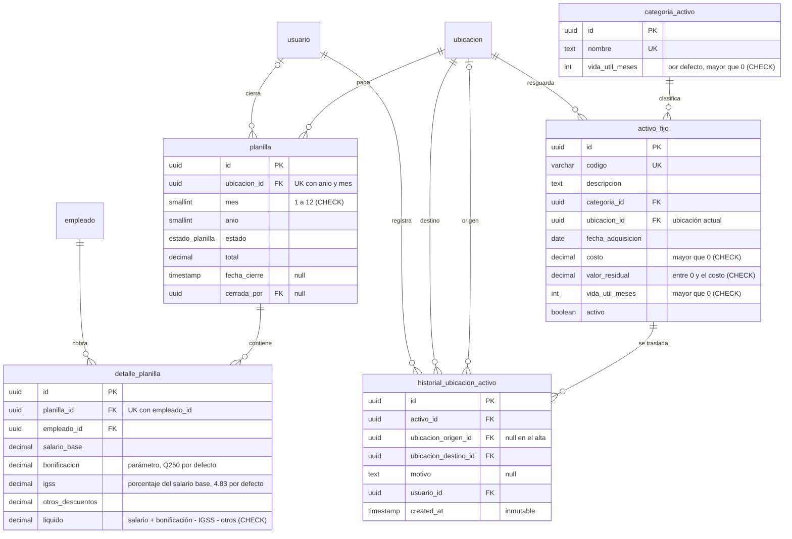

# Diagrama entidad-relación

Modelo de datos del sistema de gestión de la cadena de farmacias. Se generó a partir del esquema final [`apps/backend/prisma/schema.prisma`](../apps/backend/prisma/schema.prisma) y de las migraciones de [`apps/backend/prisma/migrations`](../apps/backend/prisma/migrations). Las restricciones que Prisma no puede declarar (CHECK, índices parciales y triggers) están en esas migraciones.

GitHub muestra los diagramas Mermaid directamente. Fuera de GitHub se pueden pegar en <https://mermaid.live>.

## Convenciones

- **Nombres:** se usan los nombres reales de la base de datos: tablas y columnas en español y en `snake_case`. En el código TypeScript, los mismos campos están en `camelCase`; por ejemplo, `fecha_vencimiento` es `fechaVencimiento`.
- **Claves primarias:** todas las tablas tienen `id` de tipo UUID.
- **Fechas de registro:**
  - Todas las tablas tienen `created_at` y `updated_at`. Para no repetirlas, los diagramas no las muestran.
  - Las tablas inmutables solo tienen `created_at`, y los diagramas sí la muestran porque ordena el historial.
- **Tablas inmutables:** `movimiento_inventario`, `movimiento_caja`, `historial_pedido`, `historial_ubicacion_activo` y `bitacora`. Un trigger rechaza cualquier `UPDATE` o `DELETE`; las correcciones se registran como movimientos nuevos.
- **Dinero:** `DECIMAL(12,2)`, nunca coma flotante. Coordenadas: `DECIMAL(9,6)`. Distancias: `DECIMAL(8,2)`.
- **Claves en los atributos:** `PK` es la clave primaria, `FK` una clave foránea y `UK` un valor único. Un comentario `null` indica que la columna admite nulos.

**Cardinalidad en Mermaid:**

| Símbolo                  | Significado                                                |
| ------------------------ | ---------------------------------------------------------- |
| `\|\|--o{`               | uno a cero o muchos                                        |
| `\|\|--\|{`              | uno a uno o muchos                                         |
| `\|o--o{`                | cero o uno a cero o muchos (la clave foránea admite nulos) |
| `\|\|--o\|` / `\|o--o\|` | uno a cero o uno                                           |

## 1. Vista general

Entidades y relaciones, sin atributos. Casi todas las tablas operativas pertenecen a una ubicación, y muchas registran qué usuario hizo la operación. Para que el diagrama se pueda leer, esas dos clases de relaciones no aparecen aquí; están en la [sección 3](#3-relaciones-con-ubicacion-y-con-usuario) y en los diagramas por módulo.

## 2. Diagramas por módulo

Cada diagrama muestra con atributos las tablas de su módulo. Las tablas de otros módulos aparecen solo con su nombre.

### 2.1 Geografía, ubicaciones, usuarios y empleados

### 2.2 Catálogo, inventario y compras

### 2.3 Traslados

Al solicitar un traslado se guardan el producto y la cantidad solicitada, sin lote. Al despachar, el sistema asigna los lotes por FEFO; un producto puede repartirse en varias filas de `detalle_traslado`, una por lote.

### 2.4 Caja y ventas

### 2.5 Clientes, pedidos y entregas

### 2.6 Planilla y activos fijos

## 3. Relaciones con ubicación y con usuario

### Ubicación

Las ubicaciones son la bodega central, las farmacias y los stands. Todas estas tablas tienen una clave foránea hacia `ubicacion`:

| Tabla                        | Columna                                       | Significado                                             |
| ---------------------------- | --------------------------------------------- | ------------------------------------------------------- |
| `usuario`                    | `ubicacion_id`                                | Ubicación asignada; nulo en los roles de alcance global |
| `empleado`                   | `ubicacion_id`                                | Lugar de trabajo                                        |
| `existencia`                 | `ubicacion_id`                                | Dónde está guardado el lote                             |
| `stock_minimo`               | `ubicacion_id`                                | Ubicación a la que aplica el mínimo                     |
| `movimiento_inventario`      | `ubicacion_id`                                | Ubicación cuyo kardex cambia                            |
| `compra`                     | `ubicacion_id`                                | Ubicación que recibe la mercadería                      |
| `traslado`                   | `origen_id`, `destino_id`                     | Ubicación que envía y ubicación que recibe              |
| `turno_caja`                 | `ubicacion_id`                                | Caja donde se abre el turno                             |
| `venta`                      | `ubicacion_id`                                | Ubicación que vende                                     |
| `pedido`                     | `ubicacion_despacho_id`                       | Ubicación que prepara y despacha el pedido              |
| `planilla`                   | `ubicacion_id`                                | Ubicación cuya planilla se calcula                      |
| `activo_fijo`                | `ubicacion_id`                                | Ubicación actual del activo                             |
| `historial_ubicacion_activo` | `ubicacion_origen_id`, `ubicacion_destino_id` | De dónde salió y a dónde llegó el activo                |

### Usuario

Además de su ubicación y su ficha de empleado, `usuario` queda registrado en cada operación que realiza:

| Tabla                        | Columna                                                                             | Papel del usuario                                           |
| ---------------------------- | ----------------------------------------------------------------------------------- | ----------------------------------------------------------- |
| `movimiento_inventario`      | `usuario_id`                                                                        | Registra el movimiento del kardex                           |
| `compra`                     | `usuario_id`                                                                        | Registra la compra                                          |
| `traslado`                   | `solicitado_por`, `aprobado_por`, `despachado_por`, `recibido_por`, `cancelado_por` | Actúa en cada cambio de estado                              |
| `turno_caja`                 | `cajero_id`                                                                         | Abre y cierra el turno                                      |
| `movimiento_caja`            | `usuario_id`                                                                        | Registra el movimiento de caja                              |
| `venta`                      | `usuario_id`, `anulada_por`                                                         | Registra la venta; el gerente la anula                      |
| `pedido`                     | `operador_id`                                                                       | Toma el pedido en el call center                            |
| `historial_pedido`           | `usuario_id`                                                                        | Cambia el estado del pedido                                 |
| `planilla`                   | `cerrada_por`                                                                       | Cierra la planilla                                          |
| `historial_ubicacion_activo` | `usuario_id`                                                                        | Traslada el activo                                          |
| `bitacora`                   | `usuario_id`                                                                        | Realiza la acción auditada; es nulo en acciones del sistema |

## 4. Enumeraciones

| Tipo                         | Valores                                                                                                   |
| ---------------------------- | --------------------------------------------------------------------------------------------------------- |
| `tipo_ubicacion`             | `BODEGA_CENTRAL`, `FARMACIA_CC`, `STAND_GASOLINERA`                                                       |
| `rol`                        | `ADMIN`, `GERENTE`, `CAJERO`, `OPERADOR_CALL_CENTER`, `AUDITOR`                                           |
| `puesto`                     | `GERENTE`, `CAJERO`, `REPARTIDOR`, `BODEGUERO`, `OPERADOR`, `OTRO`                                        |
| `tipo_movimiento_inventario` | `COMPRA`, `VENTA`, `ANULACION_VENTA`, `TRASLADO_SALIDA`, `TRASLADO_ENTRADA`, `AJUSTE`, `BAJA_VENCIMIENTO` |
| `estado_traslado`            | `SOLICITADO`, `APROBADO`, `EN_TRANSITO`, `RECIBIDO`, `CANCELADO`                                          |
| `motivo_traslado`            | `REABASTECIMIENTO`, `PEDIDO_CLIENTE`                                                                      |
| `estado_turno_caja`          | `ABIERTO`, `CERRADO`                                                                                      |
| `tipo_movimiento_caja`       | `VENTA`, `COBRO_CONTRA_ENTREGA`, `GASTO`, `RETIRO`, `DEPOSITO`, `ANULACION`                               |
| `metodo_pago`                | `EFECTIVO`, `TARJETA`, `CONTRA_ENTREGA`                                                                   |
| `canal_venta`                | `MOSTRADOR`, `CALL_CENTER`                                                                                |
| `estado_venta`               | `COMPLETADA`, `ANULADA`                                                                                   |
| `estado_pedido`              | `PENDIENTE`, `EN_PREPARACION`, `ASIGNADO`, `EN_CAMINO`, `ENTREGADO`, `CANCELADO`                          |
| `estado_planilla`            | `BORRADOR`, `CERRADA`                                                                                     |

## 5. Reglas de integridad en la base de datos

Estas reglas se cumplen en PostgreSQL aunque una consulta no pase por la API.

| Tabla                                                                                                    | Regla                                                                                                        | Mecanismo                                                         |
| -------------------------------------------------------------------------------------------------------- | ------------------------------------------------------------------------------------------------------------ | ----------------------------------------------------------------- |
| `existencia`                                                                                             | La cantidad nunca es negativa (RN-01)                                                                        | `CHECK (cantidad >= 0)`                                           |
| `stock_minimo`                                                                                           | El mínimo no es negativo                                                                                     | `CHECK (cantidad_minima >= 0)`                                    |
| `movimiento_inventario`, `movimiento_caja`, `historial_pedido`, `historial_ubicacion_activo`, `bitacora` | No se modifican ni se borran                                                                                 | Trigger `BEFORE UPDATE OR DELETE`                                 |
| `turno_caja`                                                                                             | Un cajero tiene a lo sumo un turno abierto (RN-11)                                                           | Índice único parcial sobre `cajero_id` `WHERE estado = 'ABIERTO'` |
| `turno_caja`                                                                                             | Un turno cerrado tiene cierre, efectivo esperado, efectivo contado y diferencia                              | `CHECK`                                                           |
| `turno_caja`                                                                                             | El monto inicial y el efectivo contado no son negativos                                                      | `CHECK`                                                           |
| `movimiento_caja`                                                                                        | El monto no es cero                                                                                          | `CHECK (monto <> 0)`                                              |
| `venta`                                                                                                  | El total no es negativo                                                                                      | `CHECK`                                                           |
| `detalle_venta`                                                                                          | La cantidad es positiva                                                                                      | `CHECK`                                                           |
| `pago`                                                                                                   | El monto es positivo                                                                                         | `CHECK`                                                           |
| `empleado`                                                                                               | El DPI tiene 13 dígitos y el salario es positivo                                                             | `CHECK`                                                           |
| `planilla`                                                                                               | El mes está entre 1 y 12                                                                                     | `CHECK`                                                           |
| `planilla`, `detalle_planilla`                                                                           | Una planilla cerrada y sus líneas no se modifican ni se borran (RN-23)                                       | Trigger                                                           |
| `detalle_planilla`                                                                                       | Los montos no son negativos y el líquido cuadra con salario + bonificación − IGSS − otros descuentos (RN-22) | `CHECK`                                                           |
| `activo_fijo`, `categoria_activo`                                                                        | La vida útil es positiva; el costo es positivo; el valor residual está entre 0 y el costo                    | `CHECK`                                                           |

**Valores únicos compuestos:**

- `municipio` (`departamento_id`, `nombre`)
- `lote` (`producto_id`, `numero_lote`)
- `existencia` (`ubicacion_id`, `lote_id`)
- `stock_minimo` (`ubicacion_id`, `producto_id`)
- `planilla` (`ubicacion_id`, `anio`, `mes`)
- `detalle_planilla` (`planilla_id`, `empleado_id`)

**Relaciones uno a uno:**

- `empleado.usuario_id`: una cuenta de usuario pertenece a un solo empleado.
- `venta.pedido_id`: un pedido genera una sola venta.
- `entrega.pedido_id`: un pedido tiene una sola entrega.

## 6. Referencias sin clave foránea

Tres columnas apuntan a filas de varias tablas posibles, por eso no tienen clave foránea:

- **`movimiento_inventario.referencia_tipo` y `referencia_id`:** el documento que originó el movimiento. `COMPRA` apunta a `compra`, `VENTA` a `venta`, `TRASLADO` a `traslado`; `AJUSTE` y `BAJA` no tienen documento propio.
- **`movimiento_caja.referencia_id`:** la venta de un movimiento `VENTA`, `COBRO_CONTRA_ENTREGA` o `ANULACION`. Es nulo en gastos, retiros y depósitos.
- **`bitacora.entidad` y `entidad_id`:** la tabla y el registro afectados por la acción auditada.

## 7. Índices

Además de las claves primarias y los valores únicos, la base tiene estos índices; los primeros cinco los pide la especificación (sección 6):

| Tabla                                                                           | Columnas                                                          |
| ------------------------------------------------------------------------------- | ----------------------------------------------------------------- |
| `existencia`                                                                    | `ubicacion_id`                                                    |
| `movimiento_inventario`                                                         | `ubicacion_id`, `lote_id`, `created_at`                           |
| `pedido`                                                                        | `estado`, `fecha_compromiso`                                      |
| `venta`                                                                         | `ubicacion_id`, `created_at`                                      |
| `movimiento_caja`                                                               | `turno_caja_id`                                                   |
| `movimiento_inventario`                                                         | `created_at`; `referencia_tipo`, `referencia_id`                  |
| `movimiento_caja`                                                               | `created_at`                                                      |
| `ubicacion`                                                                     | `tipo`                                                            |
| `usuario`                                                                       | `rol`; `ubicacion_id`                                             |
| `empleado`                                                                      | `ubicacion_id`, `puesto`                                          |
| `producto`                                                                      | `nombre`; `principio_activo`; `categoria_id`                      |
| `lote`                                                                          | `producto_id`, `fecha_vencimiento` (consulta FEFO)                |
| `compra`                                                                        | `ubicacion_id`, `fecha`                                           |
| `traslado`                                                                      | `estado`; `origen_id`, `created_at`; `destino_id`, `created_at`   |
| `cliente`                                                                       | `telefono`; `nit`                                                 |
| `direccion_cliente`                                                             | `cliente_id`                                                      |
| `turno_caja`                                                                    | `ubicacion_id`, `estado`; `cajero_id`, `estado`; `apertura`       |
| `venta`                                                                         | `turno_caja_id`                                                   |
| `pedido`                                                                        | `ubicacion_despacho_id`, `estado`; `cliente_id`                   |
| `historial_pedido`                                                              | `pedido_id`, `created_at`                                         |
| `entrega`                                                                       | `repartidor_id`                                                   |
| `activo_fijo`                                                                   | `ubicacion_id`; `categoria_id`                                    |
| `historial_ubicacion_activo`                                                    | `activo_id`, `created_at`                                         |
| `bitacora`                                                                      | `created_at`; `entidad`, `entidad_id`; `usuario_id`, `created_at` |
| `detalle_compra`, `detalle_traslado`, `detalle_venta`, `pago`, `detalle_pedido` | La clave foránea hacia su documento                               |

## 8. Mantenimiento

Este documento debe cambiar junto con el esquema. Cuando una migración agregue o cambie una tabla, una columna, una relación o una restricción, hay que actualizar aquí el diagrama del módulo, la vista general si cambia una relación, y las secciones 4 a 7 si corresponde.
